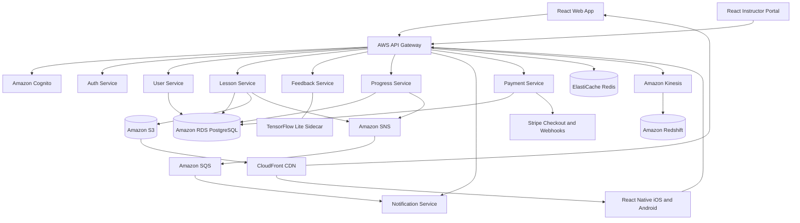

# Architecture (source: Sections 3–4)

**State:** planned architecture, not deployed or validated.

## Component diagram

**Diagram interpretation:** This is a conceptual representation of services and dependencies specified in §§3–4, not a complete network topology. In particular, arrows from API Gateway to every service are simplified; the draft describes event-driven communication without defining all exact producers and consumers. RDS is represented as one *technology family* although §3 explicitly requires independent per-service schemas.

## Service responsibilities

| Service | Responsibility | Primary Datastore | Communication |
| --- | --- | --- | --- |
| Auth Service | User authentication, token issuance, session management | Amazon Cognito | REST (sync) |
| User Service | User profile management, role assignments | RDS (PostgreSQL) | REST (sync) |
| Lesson Service | Lesson catalog, metadata, content URL signing | RDS (PostgreSQL) + S3 | REST (sync) + SNS (events) |
| Feedback Service | Real-time audio analysis, pitch/timing scoring | In-memory (stateless) | WebSocket (streaming) |
| Progress Service | Lesson completion tracking, XP accounting, badge assignment | RDS (PostgreSQL) | REST (sync) + SQS (async) |
| Notification Service | Email and push notification dispatch | SQS (consumer) | SNS (subscriber) |
| Payment Service | Stripe checkout, subscription lifecycle, webhook handling | RDS (PostgreSQL) | REST (sync) + Stripe webhooks |

## Frontend choices

| Dimension | Web Application | Mobile Application (iOS / Android) |
| --- | --- | --- |
| Framework | React 18 + TypeScript | React Native (latest stable) |
| Styling | Tailwind CSS | React Native StyleSheet + shared tokens |
| Hosting | Vercel (global edge network) | App Store / Google Play |
| State Management | Redux Toolkit (global state) + React Query (server state) | Redux Toolkit (global state) + React Query (server state) |
| Audio Capture | Web Audio API (WebRTC microphone access) | react-native-audio-recorder-player |
| Video Playback | HTML5 Video (CloudFront signed URLs) | react-native-video |
| WebSocket | Native WebSocket API | react-native-websocket |

## Backend design decisions in the draft

- **Compute:** each microservice is independently deployed on AWS ECS Fargate.
- **API entry point:** AWS API Gateway enforces JWT authorization, routing, rate limits, and CORS.
- **Communication:** REST for synchronous queries; SQS/SNS for asynchronous events; WebSocket streams for live audio feedback.
- **Database ownership:** each service owns its domain; the source states that no microservice shares a database schema with another.
- **Caching:** Redis for sessions and lesson metadata; lesson metadata cache TTL = 300 s (LRU eviction).
- **Media:** S3 objects with CloudFront signed URLs; 3,600 s signature expiry.
- **Audio feedback:** 250 ms PCM chunks, preprocessing (noise reduction and normalization), TFLite scoring on pitch, timing, rhythm, structured JSON response over WebSocket.
- **Analytics:** Kinesis event streams into Redshift.
- **AWS App Mesh:** included by source as service mesh and circuit-breaker dependency; validate current availability and migration implications before provisioning.

## Audio engine: source-defined metrics

- **Pitch accuracy:** cents deviation relative to expected pitch.
- **Timing deviation:** milliseconds ahead of or behind the beat.
- **Rhythm consistency:** beat regularity coefficient.

The model artifact is stored on S3 and loaded via `AUDIO_MODEL_PATH` at sidecar startup; live hot-swapping is future work (§4.4).

## Scaling in §5.3

- ECS each service: min 2, max 20 tasks; 70% average CPU target; scale-out cooldown 60 s; scale-in cooldown 300 s.
- RDS Multi-AZ plus read replicas for Lesson and Progress service workloads.
- Redis three nodes (primary + 2 replicas), automatic failover; stated primary promotion target within 60 s.
- CloudFront signed URL expiry 3,600 s.

## Unresolved implementation decisions

Backend language/framework is unspecified; do not infer a runtime from the logging library example alone. The draft includes an incomplete high-resolution architecture diagram placeholder (Appendix A); the Mermaid above is supplied for planning. See [open questions](open-questions.md).
