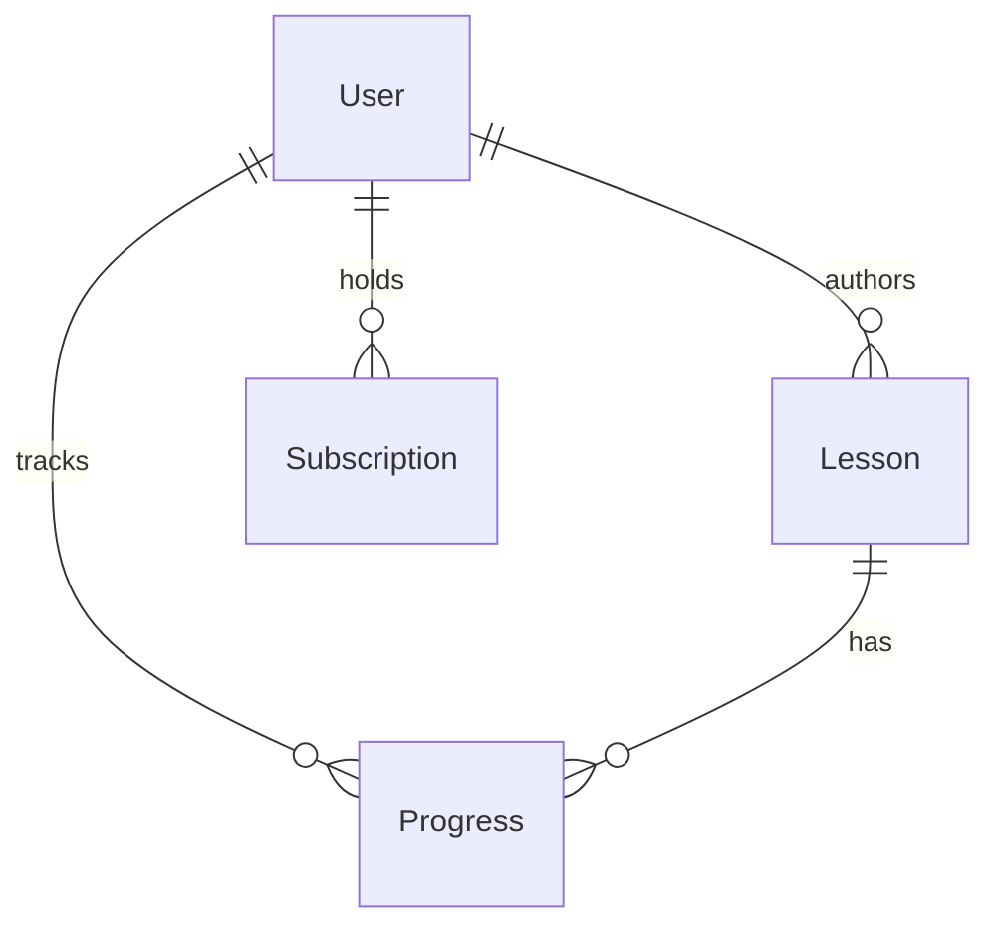

# Data model specification (source: Section 6.1)

The source defines four core entities. UUID version 4 primary keys are generated at the application layer; all timestamps are UTC. Field spelling and constraints below are taken from the document verbatim where possible.

## User

| Field | Type | Constraints | Description |
| --- | --- | --- | --- |
| userId | UUID | PRIMARY KEY | Unique user identifier |
| email | VARCHAR(320) | UNIQUE, NOT NULL | User's email address; used for authentication |
| passwordHash | VARCHAR(255) | NOT NULL | bcrypt hash of user password (managed by Cognito) |
| displayName | VARCHAR(100) | NOT NULL | Public-facing display name |
| role | ENUM | NOT NULL | One of: Learner, Instructor, Admin |
| subscriptionTier | ENUM | NOT NULL, DEFAULT 'Free' | One of: Free, Premium, Pro |
| createdAt | TIMESTAMPTZ | NOT NULL | Account creation timestamp (UTC) |
| updatedAt | TIMESTAMPTZ | NOT NULL | Last profile update timestamp (UTC) |

## Lesson

| Field | Type | Constraints | Description |
| --- | --- | --- | --- |
| lessonId | UUID | PRIMARY KEY | Unique lesson identifier |
| title | VARCHAR(255) | NOT NULL | Human-readable lesson title |
| instrument | VARCHAR(100) | NOT NULL | Instrument name (e.g., Guitar, Piano, Violin) |
| difficulty | ENUM | NOT NULL | One of: Beginner, Intermediate, Advanced |
| videoUrl | VARCHAR(1024) | NOT NULL | S3 object key for lesson video asset |
| audioTrackUrl | VARCHAR(1024) | NULLABLE | S3 object key for backing audio track |
| sheetMusicUrl | VARCHAR(1024) | NULLABLE | S3 object key for sheet music PDF |
| durationSeconds | INTEGER | NOT NULL | Total lesson duration in seconds |
| instructorId | UUID | FK → User.userId | Reference to the authoring instructor |
| tags | TEXT[] | NULLABLE | Array of searchable tags (genre, technique, level) |
| createdAt | TIMESTAMPTZ | NOT NULL | Lesson publication timestamp (UTC) |

## Progress

| Field | Type | Constraints | Description |
| --- | --- | --- | --- |
| progressId | UUID | PRIMARY KEY | Unique progress record identifier |
| userId | UUID | FK → User.userId | Learner this record belongs to |
| lessonId | UUID | FK → Lesson.lessonId | Lesson this record tracks |
| completionPercentage | DECIMAL(5,2) | NOT NULL, DEFAULT 0.00 | Lesson completion percentage (0.00 – 100.00) |
| pitchAccuracyScore | DECIMAL(5,2) | NULLABLE | Average pitch accuracy score from last attempt (0–100) |
| timingScore | DECIMAL(5,2) | NULLABLE | Timing consistency score from last attempt (0–100) |
| attemptCount | INTEGER | NOT NULL, DEFAULT 0 | Total number of practice attempts for this lesson |
| lastAttemptAt | TIMESTAMPTZ | NULLABLE | Timestamp of the most recent practice attempt (UTC) |
| badgesEarned | TEXT[] | NULLABLE | Array of badge identifiers earned for this lesson |

## Subscription

| Field | Type | Constraints | Description |
| --- | --- | --- | --- |
| subscriptionId | UUID | PRIMARY KEY | Unique subscription record identifier |
| userId | UUID | FK → User.userId | User this subscription belongs to |
| plan | ENUM | NOT NULL | One of: Free, Premium, Pro |
| stripeSubscriptionId | VARCHAR(255) | NULLABLE | Stripe subscription identifier (null for Free plan) |
| status | ENUM | NOT NULL | One of: active, past_due, cancelled, trialing |
| startDate | DATE | NOT NULL | Subscription start date |
| renewalDate | DATE | NULLABLE | Next billing renewal date (null for Free plan) |

## High-level relationships

The ERD is a conceptual rendering of the relational references and the image in **Appendix B (page 30)**. It is **not** an SQL migration or a claim that cross-service foreign keys can be deployed unchanged.

## Design verification items

1. §3 states that each microservice uses an independent database schema, but the core entity table describes cross-entity database foreign keys (`Lesson.instructorId → User.userId`, `Progress.userId → User.userId`, `Subscription.userId → User.userId`). Confirm database and service boundaries before building physical FK constraints.
2. `User.passwordHash` is described as a local, non-null field even though Cognito is the identity provider. Determine whether passwords/hashes are intended to exist within MIH's database; no hash synchronization mechanism is defined.
3. The source lists a `Subscription` table and a `User.subscriptionTier` field but does not specify reconciliation rules or webhook idempotency.
4. The source does not define uniqueness guarantees for per-user/per-lesson progress, or cardinality of user subscriptions across history.
5. See [open questions](open-questions.md) for decisions required before migrations.
